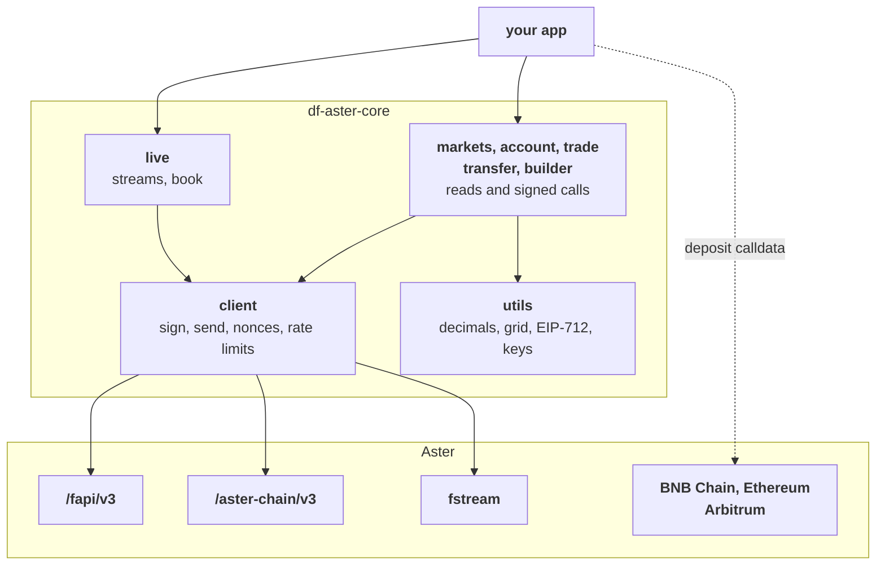

<p align="center">
  <a href="https://dfurrer.com">
    <picture>
      <source media="(prefers-color-scheme: dark)" srcset="https://dfu-cl-storybook.pages.dev/brand/markdfu-raised.svg">
      
    </picture>
  </a>
</p>

# df-aster-core

Rust SDK for [Aster](https://www.asterdex.com) futures: markets, account, trading, agents, transfers, deposits, withdrawals and websocket streams in one crate, with exact decimals, EIP-712 signing in Rust and native or wasm transports.

## SDK

```text
df-aster-core
├── client          the Client, agent signing, nonces, the clock, rate limits, the hosts
│   ├── http        the REST API, the wire, calls, refusals by code, the weight gate
│   ├── native      reqwest and tokio-tungstenite (feature native)
│   └── web         fetch and WebSocket (feature web)
├── markets         what is listed and what it trades at
│   ├── info        symbols, filters, grids, assets, rate limits
│   ├── book        depth
│   ├── trades      the tape, older trades, aggregate trades
│   ├── klines      trade, index price and mark price candles
│   ├── prices      mark and index prices, index references
│   ├── funding     settled rates, each symbol's interval, cap and floor
│   ├── tickers     the day, last price, best bid and ask
│   └── system      ping, server time, asset logos
├── account         what an account holds and who may act for it
│   ├── holdings    balances, the account, positions, commission, brackets, ADL, openable notional
│   ├── history     orders, fills, income, liquidations, margin changes
│   ├── settings    position mode, STP mode, multi-assets mode, MMP, referrals
│   ├── agents      what the main wallet signs: agents, builders, registration, asset migration
│   ├── subaccounts bind, create, list, update
│   └── notices     announcements sent to the account
├── trade           orders on every symbol
│   ├── orders      limit, market, stop, take-profit, trailing stop, batches, builder fees, the grid
│   ├── manage      cancel, cancel all, auto-cancel, modify, chase
│   ├── margin      leverage, margin type, isolated margin
│   ├── strategy    OTO, OCO and OTOCO
│   └── tracked     calls signed at a chosen nonce, guarded cancels, noop
├── transfer        moving money
│   ├── wallet      futures and spot, asset exchange
│   ├── sub_account between a main account and its sub-accounts
│   ├── withdraw    EVM and Solana withdrawals, limits, history, fees
│   ├── deposit     vault calldata on Ethereum, BNB Chain and Arbitrum, asset lists
│   └── chain       transfers on Aster Chain, privacy status
├── builder         what a builder reads about the users that approved it
├── live            streams, frames, the account stream, connection state, the kept book
└── utils           decimals, grids, addresses, enums, nonces, keccak, EIP-712, secp256k1
```



## Examples

| Example | What it does |
|---|---|
| `cargo run -p df-aster-core --example market_order` | Reads BTCUSDT's rules and book from Aster (or `-- ETHUSDT`), prints the unsigned market order for a $100 buy |

## Tests

```text
packages/core
├── src/**/tests       unit: decimals, grids, encoding, signing, refusals, every call and every answer
├── tests
│   ├── conformance    every signature matches eth_account running Aster's own demo, and globe.li on viem
│   ├── mocked         whole journeys through Client against a fake venue that checks every signature
│   └── live           read only: every public read and the market streams
├── fixtures           recorded venue answers and frames, and the docs' examples for account calls
└── vectors            what eth_account and viem produce, and the program that made them
```

| Command | What it runs |
|---|---|
| `just check` | format, lint, unit, conformance, mocked, the browser transport in Node, docs |
| `just live` | the live suite against Aster, each answer held against its recording |
| `just cover` | line coverage of everything but the live suite |

<br>

<p align="center">
  <sub><sub><a href="https://dfurrer.com">DFU</a></sub></sub>
  &emsp;&emsp;&emsp;
  <sub><a href="https://dfurrer.com">dfurrer.com</a></sub>
  &emsp;&emsp;&emsp;
  <sub><sub><a href="https://dfurrer.com">df.aster</a></sub></sub>
</p>
